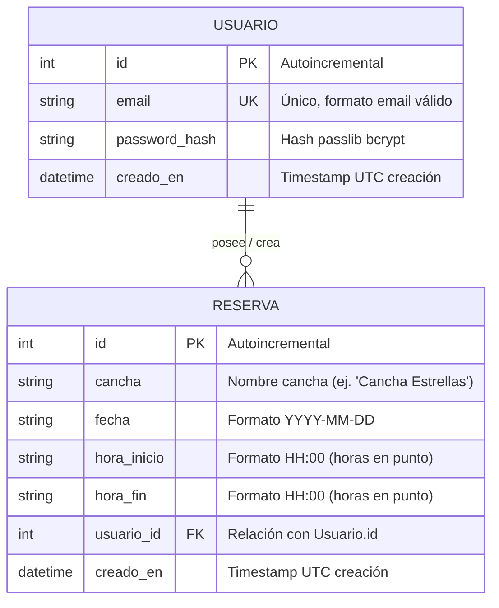

# Data Model: Sistema de Reservas para Cancha Sintética "Estrellas"

**Branch**: `001-reservas-cancha` | **Date**: 2026-09-19 | **Feature**: [spec.md](./spec.md)

## 1. Entities & Relational Schema

---

## 2. Table Specifications

### Table: `usuarios`
| Column | Type | Constraints | Description |
|--------|------|-------------|-------------|
| `id` | `INTEGER` | PRIMARY KEY, AUTOINCREMENT | Identificador único del usuario |
| `email` | `VARCHAR(255)` | UNIQUE, NOT NULL, INDEXED | Correo electrónico del usuario |
| `password_hash` | `VARCHAR(255)` | NOT NULL | Hash seguro generado con bcrypt |
| `creado_en` | `DATETIME` | NOT NULL, DEFAULT `CURRENT_TIMESTAMP` | Fecha y hora de registro |

### Table: `reservas`
| Column | Type | Constraints | Description |
|--------|------|-------------|-------------|
| `id` | `INTEGER` | PRIMARY KEY, AUTOINCREMENT | Identificador único de la reserva |
| `cancha` | `VARCHAR(100)` | NOT NULL, INDEXED | Nombre o identificador de la cancha |
| `fecha` | `VARCHAR(10)` | NOT NULL, INDEXED | Fecha de la reserva en formato `YYYY-MM-DD` |
| `hora_inicio` | `VARCHAR(5)` | NOT NULL | Hora de inicio en formato `HH:00` |
| `hora_fin` | `VARCHAR(5)` | NOT NULL | Hora de finalización en formato `HH:00` |
| `usuario_id` | `INTEGER` | NOT NULL, FOREIGN KEY (`usuarios.id`), INDEXED | ID del usuario propietario |
| `creado_en` | `DATETIME` | NOT NULL, DEFAULT `CURRENT_TIMESTAMP` | Fecha y hora de creación |

---

## 3. Domain Entity DTOs / Pydantic Schemas

### Schemas: `Usuario`
- `UsuarioCreate`: `{ email: EmailStr, password: str }` (valida password mínimo 6 caracteres).
- `UsuarioResponse`: `{ id: int, email: str, creado_en: datetime }` (la contraseña o hash NUNCA se incluye).
- `TokenResponse`: `{ access_token: str, token_type: "bearer" }`.

### Schemas: `Reserva`
- `ReservaCreate`: `{ cancha: str = "Cancha Estrellas", fecha: date, hora_inicio: str, hora_fin: str }` (valida formato `HH:00`).
- `ReservaResponse`: `{ id: int, cancha: str, fecha: str, hora_inicio: str, hora_fin: str, usuario_id: int, creado_en: datetime }`.

---

## 4. Business Validation & Constraint Rules

1. **Horas en punto (`HH:00`)**: `hora_inicio` y `hora_fin` deben terminar estrictamente en `:00`.
2. **Orden temporal**: `hora_fin > hora_inicio`.
3. **Duración mínima**: `duracion_en_horas(hora_inicio, hora_fin) >= 1`.
4. **Prevención de solapamiento**: Para cualquier reserva existente en la misma `cancha` y `fecha`, no puede existir intersección de intervalos:
   $$\text{Solapamiento} \iff (\text{inicio\_existente} < \text{fin\_nuevo}) \land (\text{fin\_existente} > \text{inicio\_nuevo})$$
5. **Aislamiento de Usuario**: Al listar o cancelar, las consultas imponen `WHERE usuario_id = :current_user_id`.
